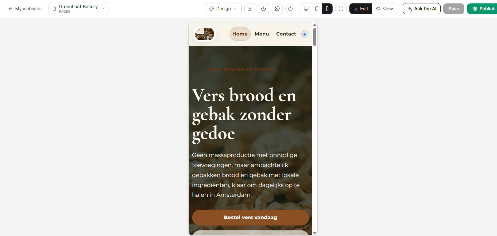
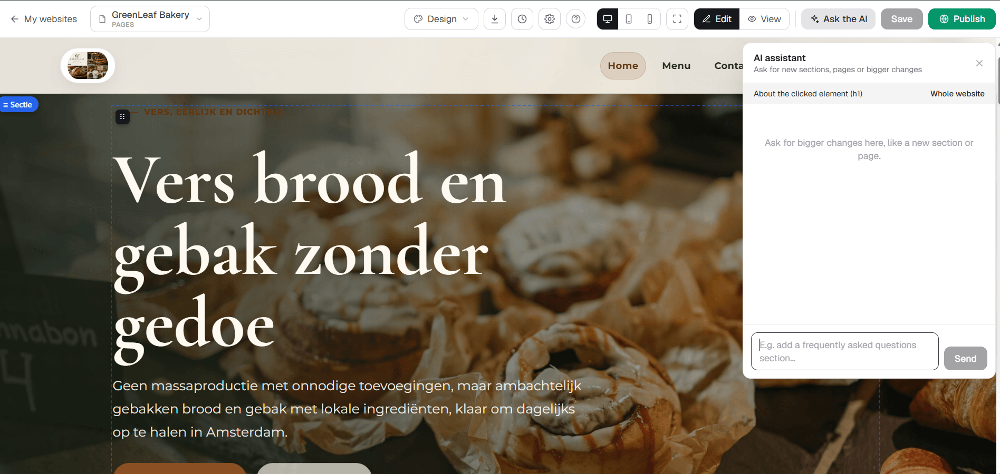
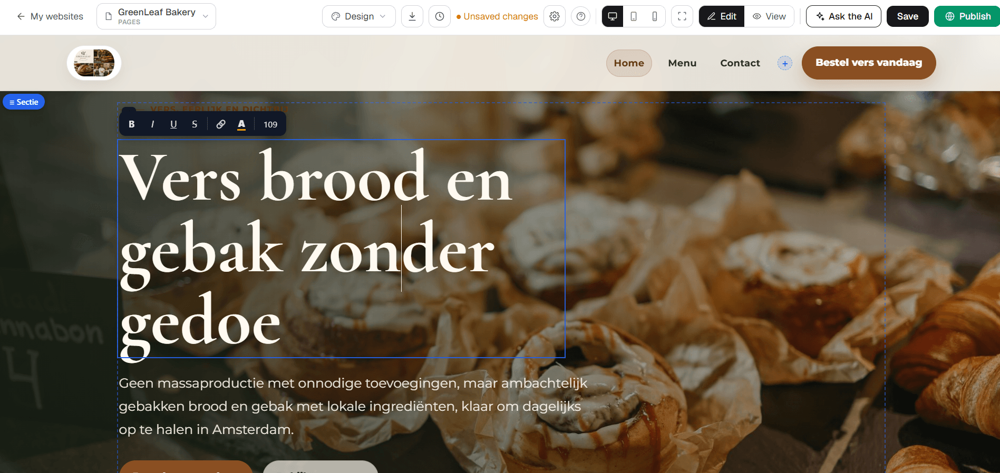

<strong>Before you start:</strong> open any website from your dashboard. The editor shows your site exactly as visitors see it, so there is no separate editing view to learn.

<strong>Tip:</strong> the editor has a built-in walkthrough. Use the <strong>?</strong> icon to start the <strong>Basic tour</strong> or the <strong>Advanced tour</strong> at any time, or choose <strong>Replay the tour</strong>.

## 1. Pages

Every site starts with a homepage. Use **Pages** to move between pages, or click **New page** to add one. You can start from **Blank** or from a ready-made layout such as Team, FAQ or Contact. **Delete page** removes a page you no longer need, and you can find it again under your earlier versions.

## 2. Click to edit

Click any text or photo to change it. When you click into text, a small toolbar appears for bold, italic, colour and text size. Click a photo to choose another one under **Choose a photo**, upload a new one with **Upload a new photo**, or add a short description for search engines and screen readers.

For a button or link, a small panel asks where it should go. A button can be **A link**, **A download** or **A newsletter signup**.

## 3. Design and sections

The **Design** menu is where you add sections, have a selection auto-styled, and adjust how your pop-ups look. The **Sections** panel offers ready-made blocks, such as a hero, features, FAQ, contact, call to action or gallery. Fill in a little content, then use **Style all unstyled sections** to match the new block to the rest of your site.

## 4. Downloads

Under **Downloads** you can upload a PDF or zip, such as a brochure or a catalogue. Link it to any button by choosing **A download**, then pick whether the visitor gets an **Instant download** or has the file **Emailed to visitor**.

## 5. History

Something went wrong? Open **History** to see earlier versions. Click **Restore** on the one you want. Your current version stays in the list, so nothing is lost.

## 6. View sizes

Switch between **Desktop**, **Tablet** and **Phone** to check how your site looks at every size.

*Phone view: the page as it looks on a phone.*

## 7. Ask the AI

Click **Ask the AI** for bigger changes, such as a new section or page, or a different feel for the whole site. Type what you want in plain words, for example "add a frequently asked questions section". If a change does not work, your website is left as it was.

*The AI assistant, opened with Ask the AI.*

## 8. Save

Changes appear straight away in the preview, but they are only kept when you click **Save**. **Discard changes** throws away what you have not saved.

*Unsaved changes: click Save to keep them.*

## 9. Publish

When you are happy, click **Publish**. After your first publish the button reads **Publish again**, and **Unpublish** takes the site offline.

## 10. Manage

**Manage** holds everything that is not part of the site itself: **Leads**, **Audience**, **Campaigns**, **Follow-up emails**, **Sender**, **Brand**, **Domain**, **Website** and **Stats**. Use **Back to editor** to return.

<strong>Note:</strong> on a phone, Webgnr shows quick actions (publish, ask the AI, earlier versions, manage) instead of the full editor. The full editor works best on a tablet or computer.

## Next steps

<a class="next-card" href="/docs/forms-and-leads/"><strong>Forms and leads</strong>See who gets in touch.</a>
<a class="next-card" href="/docs/connect-your-domain/"><strong>Connect your domain</strong>Use your own web address.</a>

