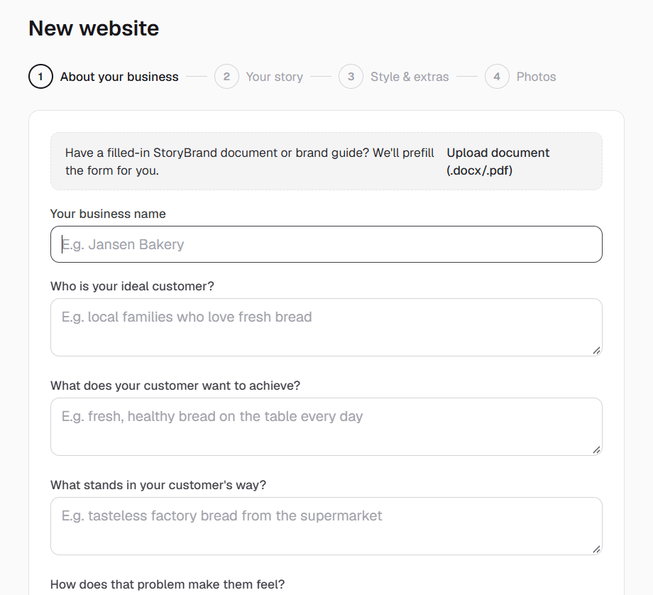

<strong>Before you start:</strong> have a short description of your business, your ideal customer and a few photos ready. You can skip the photos and add them later.

## 1. Start a new website

Sign in and click **New website** on your dashboard.

## 2. Answer the brief

The brief asks about your business the way a copywriter would. The answers become the words on your site, so write them as you would explain them to a customer.

- Your business name and your ideal customer
- What your customer wants, and what stands in their way
- Why customers can trust you, and the main action on your site
- Your plan in three steps, your languages and, if you like, a preferred style (optional)

*The brief has four steps, starting with About your business.*

<strong>Tip:</strong> questions marked optional can be left blank. Short, honest answers work better than long ones.

## 3. Add photos

Upload your own photos or describe the ones you want. Webgnr places them on the right pages.

## 4. Review and edit

Your site opens in the editor. From here you can:

- Click any text to change it
- Adjust colours and fonts under **Design**
- Ask the **AI assistant** for bigger changes, such as "add a team section"
- Go back to an earlier version under **History**

Click **Save** when you are happy with your changes.

## 5. Publish

Click **Publish**. Your site goes online at a free address, and you can add your own domain afterwards.

## Next steps

<a class="next-card" href="/docs/connect-your-domain/"><strong>Connect your domain</strong>Use your own web address.</a>
<a class="next-card" href="/docs/set-up-your-sender/"><strong>Set up your sender</strong>Email from your own address.</a>

