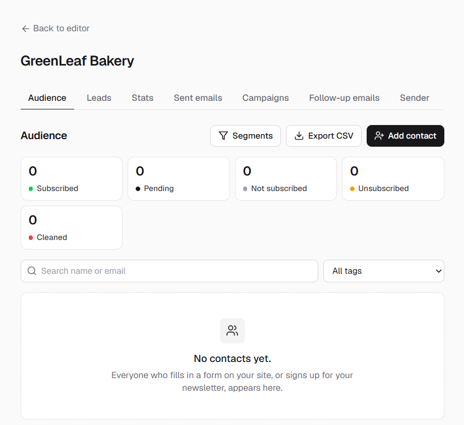

<strong>Before you start:</strong> your site needs a form. WebGen sites usually include a contact section. You can add more, or a download or newsletter button, in the editor.

## 1. Know the three kinds of form

WebGen sorts what visitors send into three kinds, and labels each one in your list.

- **Contact**: a message from your contact form.
- **Download**: a request for a file you offer, such as a brochure.
- **Newsletter**: someone who signed up with their email address.

To add one, open the editor and use the **Sections** panel to add a contact block, or link a button to **A download** or **A newsletter signup**. See [A tour of the editor](/docs/a-tour-of-the-editor/).

If you imported your own site, forms with an email field are connected for you. See [Import an existing site](/docs/import-an-existing-site/).

## 2. Publish and test

Click **Publish**, open your live site and send yourself a message through the form.

## 3. See your leads

Click **Manage**, then the **Leads** tab. The page is titled **Form submissions**, and every new message appears here. Each row shows its kind. For a download request you also see the **Requested file**.

Use the filters at the top to switch between **Real**, **Spam** and **All**. Messages WebGen recognises as spam carry a **Spam** badge, and people who opted out carry an **Unsubscribed** badge.

When nothing has arrived yet, the page says **No submissions yet.**

## 4. Get notified

You can be emailed whenever a lead arrives. Open **Manage**, then the **Emails** tab.

- Under **Receive notifications at**, enter up to 5 addresses separated by commas. Leave it blank to use your account email.
- Use **Reply-to address for visitor emails** so that replies from visitors go straight to your own mailbox.

The same tab lets you edit the emails your site sends, such as the automatic reply to a contact form.

## 5. Ask permission to email people

To send campaigns or follow-up emails to the people who fill in a form, they must agree first. In the editor, select the section with the form and turn on **Ask permission for follow-up emails**. This adds an optional, unticked checkbox to the form. Only visitors who tick it can receive follow-up emails.

<strong>Tip:</strong> turn this on for every form where you plan to follow up. Newsletter signups already count as permission to send your newsletter.

## 6. Everyone in one list

Everyone who fills in a form, or signs up for your newsletter, also appears under **Audience**. You can search by name or email, filter by tag, add people by hand with **Add contact**, and download the list with **Export CSV**. Each person has a page with their details, tags and activity. Use **View in Leads** there to jump to their messages.

*The Audience tab before anyone has signed up.*

## 7. Delete a submission

Click **Delete** on a lead to remove it. This cannot be undone.

<strong>Note:</strong> you can ask new newsletter subscribers to confirm their email first. Under <strong>Campaigns</strong>, turn on <strong>Ask new subscribers to confirm their email</strong>.

## Next steps

<a class="next-card" href="/docs/follow-up-emails/"><strong>Follow-up emails</strong>Reply to new leads automatically.</a>
<a class="next-card" href="/docs/send-a-campaign/"><strong>Send a campaign</strong>Email your audience.</a>

