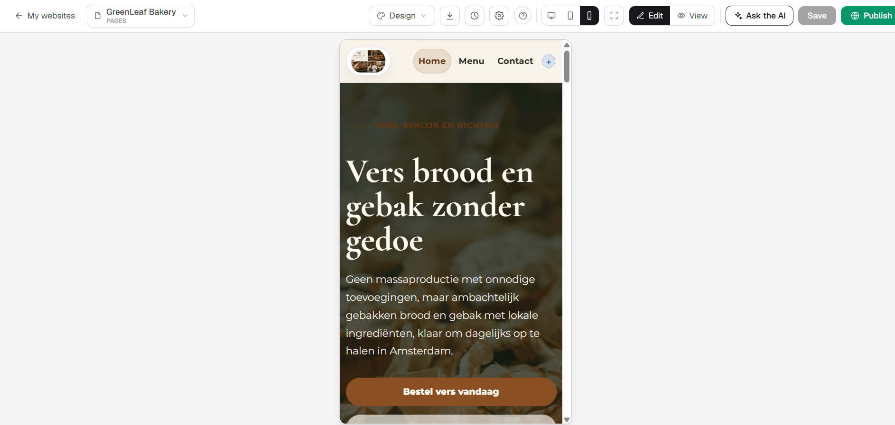
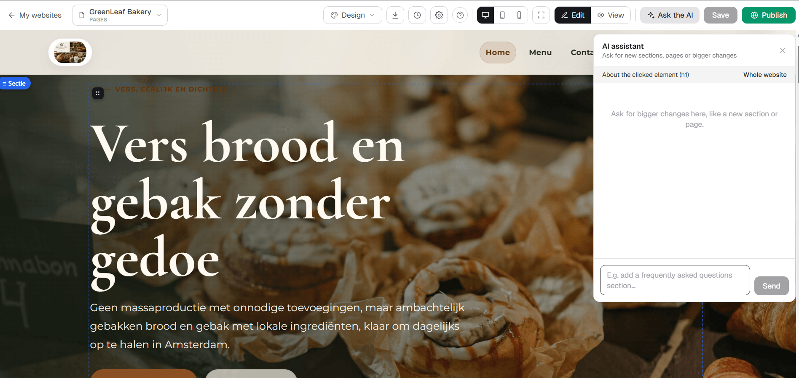
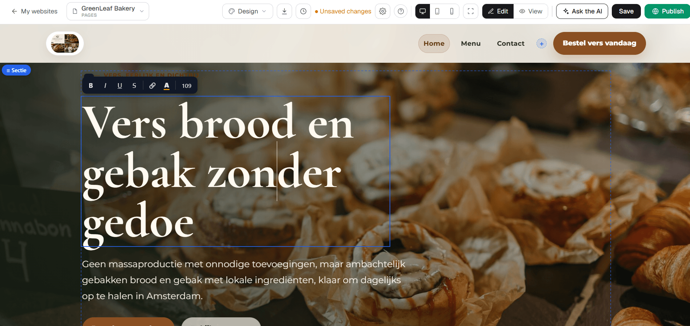

<strong>Voor je begint:</strong> open een website vanuit je dashboard. De editor toont je site precies zoals bezoekers hem zien, dus je hoeft geen aparte bewerkweergave te leren.

<strong>Tip:</strong> de editor heeft een ingebouwde rondleiding. Gebruik het <strong>?</strong>-pictogram om de <strong>Basisrondleiding</strong> of de <strong>Uitgebreide rondleiding</strong> op elk moment te starten, of kies <strong>Rondleiding opnieuw bekijken</strong>.

## 1. Pagina's

Elke site begint met een homepage. Gebruik **Pagina's** om tussen pagina's te wisselen of klik op **Nieuwe pagina** om er een toe te voegen. Je kunt beginnen met een lege pagina of met een kant-en-klare opmaak zoals Team, FAQ of Contact. **Pagina verwijderen** verwijdert een pagina die je niet meer nodig hebt en je vindt hem terug onder je eerdere versies.

## 2. Klik om te bewerken

Klik op een tekst of foto om die te wijzigen. Als je in een tekst klikt, verschijnt een kleine werkbalk voor vet, cursief, kleur en tekstgrootte. Klik op een foto om een andere te kiezen met **Kies een foto**, upload een nieuwe met **Nieuwe foto uploaden**, of voeg een korte beschrijving toe voor zoekmachines en schermlezers.

Bij een knop of link vraagt een klein paneel waar die naartoe moet. Een knop kan **Een link**, **Een download** of **Een nieuwsbrief-aanmelding** zijn.

## 3. Ontwerp en secties

Het menu **Ontwerp** is de plek om secties toe te voegen, een selectie automatisch te laten stylen en de weergave van je pop-ups aan te passen. Het paneel **Secties** biedt kant-en-klare blokken, zoals een hero, functies, FAQ, contact, call-to-action of galerij. Vul wat inhoud in en gebruik daarna **Alle openstaande secties stylen** om het nieuwe blok bij de rest van je site te laten passen.

## 4. Downloads

Onder **Downloads** kun je een pdf of zip uploaden, zoals een brochure of catalogus. Koppel hem aan een knop door **Een download** te kiezen en kies dan of de bezoeker **Direct downloaden** krijgt of dat het bestand **Gemaild naar bezoeker** wordt.

## 5. Geschiedenis

Ging er iets mis? Open **Geschiedenis** om eerdere versies te zien. Klik op **Terugzetten** bij de versie die je wilt. Je huidige versie blijft in de lijst staan, dus er gaat niets verloren.

## 6. Schermformaten

Schakel tussen **Desktop**, **Tablet** en **Telefoon** om te zien hoe je site er op elk formaat uitziet.

*Telefoonweergave: de pagina zoals hij op een telefoon eruitziet. (Screenshot met Engelse interface.)*

## 7. Vraag de AI

Klik op **Vraag de AI** voor grotere wijzigingen, zoals een nieuwe sectie of pagina, of een andere uitstraling voor de hele site. Typ in gewone woorden wat je wilt, bijvoorbeeld "voeg een sectie met veelgestelde vragen toe". Werkt een wijziging niet, dan blijft je website zoals hij was.

*De AI-assistent, geopend met Vraag de AI. (Screenshot met Engelse interface.)*

## 8. Opslaan

Wijzigingen verschijnen meteen in het voorbeeld, maar ze worden pas bewaard als je op **Opslaan** klikt. **Wijzigingen ongedaan maken** gooit weg wat je nog niet hebt opgeslagen.

*Niet-opgeslagen wijzigingen: klik op Opslaan om ze te bewaren. (Screenshot met Engelse interface.)*

## 9. Publiceren

Klik op **Publiceren** als je tevreden bent. Na je eerste keer publiceren staat er op de knop **Opnieuw publiceren** en met **Depubliceren** haal je de site offline.

## 10. Beheren

**Beheren** bevat alles wat niet bij de site zelf hoort: **Inzendingen**, **Doelgroep**, **Campagnes**, **Vervolgmails**, **Afzender**, **Huisstijl**, **Domein**, **Website** en **Statistieken**. Gebruik **Terug naar editor** om terug te gaan.

<strong>Let op:</strong> op een telefoon toont Webgnr snelle acties (publiceren, de AI vragen, eerdere versies, beheren) in plaats van de volledige editor. De volledige editor werkt het best op een tablet of computer.

## Volgende stappen

<a class="next-card" href="/nl/docs/forms-and-leads/"><strong>Formulieren en leads</strong>Zie wie contact opneemt.</a>
<a class="next-card" href="/nl/docs/connect-your-domain/"><strong>Koppel je domein</strong>Gebruik je eigen webadres.</a>

