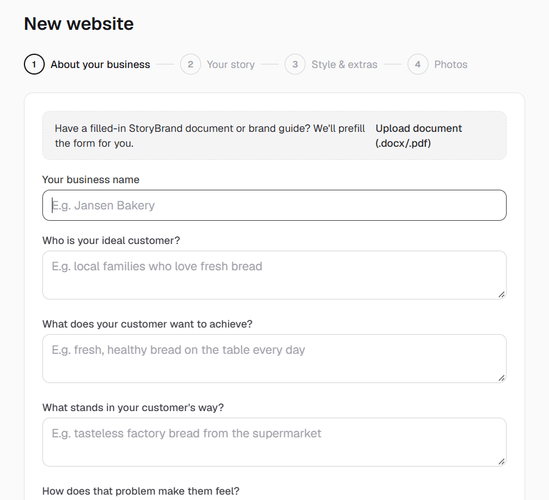

<strong>Voor je begint:</strong> zorg voor een korte beschrijving van je bedrijf, je ideale klant en een paar foto's. De foto's kun je overslaan en later toevoegen.

## 1. Begin met een nieuwe website

Log in en klik op **Nieuwe website** op je dashboard.

## 2. Beantwoord de briefing

De briefing vraagt naar je bedrijf zoals een copywriter dat zou doen. Je antwoorden worden de woorden op je site, dus schrijf ze zoals je het aan een klant zou uitleggen.

- De naam van je bedrijf en je ideale klant
- Wat je klant wil bereiken en wat hem in de weg staat
- Waarom klanten je kunnen vertrouwen en wat de belangrijkste actie op je site is
- Jouw plan in drie stappen, je talen en, als je wilt, een gewenste stijl (optioneel)

*De briefing heeft vier stappen, te beginnen met Over je bedrijf.*

<strong>Tip:</strong> vragen die als optioneel zijn gemarkeerd, kun je leeg laten. Korte, eerlijke antwoorden werken beter dan lange.

## 3. Voeg foto's toe

Upload je eigen foto's of beschrijf welke je wilt. Webgnr zet ze op de juiste pagina's.

## 4. Bekijk en bewerk

Je site opent in de editor. Vanaf hier kun je:

- Op een tekst klikken om die te wijzigen
- Kleuren en lettertypen aanpassen onder **Ontwerp**
- De **AI-assistent** om grotere wijzigingen vragen, zoals "voeg een teamsectie toe"
- Terug naar een eerdere versie onder **Geschiedenis**

Klik op **Opslaan** als je tevreden bent met je wijzigingen.

## 5. Publiceren

Klik op **Publiceren**. Je site gaat online op een gratis adres en je kunt daarna je eigen domein toevoegen.

## Volgende stappen

<a class="next-card" href="/nl/docs/connect-your-domain/"><strong>Koppel je domein</strong>Gebruik je eigen webadres.</a>
<a class="next-card" href="/nl/docs/set-up-your-sender/"><strong>Stel je afzender in</strong>Mail vanaf je eigen adres.</a>

