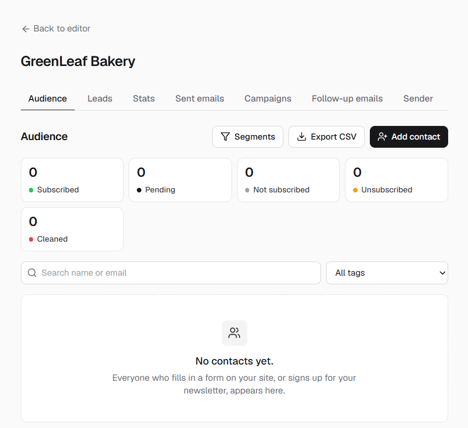

<strong>Voor je begint:</strong> je site heeft een formulier nodig. WebGen-sites bevatten meestal een contactsectie. Je kunt er meer toevoegen, of een download- of nieuwsbriefknop, in de editor.

## 1. Ken de drie soorten formulieren

WebGen sorteert wat bezoekers sturen in drie soorten en zet bij elke inzending het soort.

- **Contact**: een bericht uit je contactformulier.
- **Download**: een verzoek om een bestand dat je aanbiedt, zoals een brochure.
- **Nieuwsbrief**: iemand die zich met zijn e-mailadres heeft aangemeld.

Om er een toe te voegen, open je de editor en gebruik je het paneel **Secties** om een contactblok toe te voegen, of koppel je een knop aan **Een download** of **Een nieuwsbrief-aanmelding**. Zie [Rondleiding door de editor](/nl/docs/a-tour-of-the-editor/).

Heb je je eigen site geïmporteerd, dan worden formulieren met een e-mailveld voor je gekoppeld. Zie [Een bestaande site importeren](/nl/docs/import-an-existing-site/).

## 2. Publiceer en test

Klik op **Publiceren**, open je live site en stuur jezelf een bericht via het formulier.

## 3. Bekijk je leads

Klik op **Beheren** en dan op het tabblad **Inzendingen**. De pagina heet **Formulierinzendingen** en elk nieuw bericht verschijnt hier. Bij elke rij staat het soort. Bij een downloadverzoek zie je ook het **Opgevraagd bestand**.

Gebruik de filters bovenaan om te wisselen tussen **Echt**, **Spam** en **Alles**. Berichten die WebGen als spam herkent, krijgen een **Spam**-label en mensen die zich hebben afgemeld krijgen een label **Uitgeschreven**.

Is er nog niets binnengekomen, dan staat er **Nog geen inzendingen.**

## 4. Krijg een melding

Je kunt een e-mail krijgen zodra er een lead binnenkomt. Open **Beheren** en dan het tabblad **E-mails**.

- Vul onder **Meldingen ontvangen op** maximaal 5 adressen in, gescheiden door komma's. Laat het leeg om het e-mailadres van je account te gebruiken.
- Gebruik **Antwoordadres voor bezoeker-e-mails** zodat antwoorden van bezoekers direct in je eigen mailbox komen.

Op hetzelfde tabblad pas je ook de e-mails aan die je site verstuurt, zoals het automatische antwoord op een contactformulier.

## 5. Vraag toestemming om mensen te mailen

Om campagnes of vervolgmails te sturen naar mensen die een formulier invullen, moeten ze eerst akkoord gaan. Selecteer in de editor de sectie met het formulier en zet **Toestemming vragen voor vervolgmails** aan. Dit voegt een optioneel, niet-aangevinkt vakje aan het formulier toe. Alleen bezoekers die het aanvinken, kunnen vervolgmails ontvangen.

<strong>Tip:</strong> zet dit aan bij elk formulier waarvoor je wilt opvolgen. Nieuwsbriefaanmeldingen tellen al als toestemming om je nieuwsbrief te sturen.

## 6. Iedereen in één lijst

Iedereen die een formulier invult of zich aanmeldt voor je nieuwsbrief, staat ook onder **Doelgroep**. Je kunt zoeken op naam of e-mailadres, filteren op tag, mensen met de hand toevoegen met **Contact toevoegen** en de lijst downloaden met **CSV exporteren**. Elke persoon heeft een pagina met gegevens, tags en activiteit. Gebruik daar **Bekijk bij Leads** om naar hun berichten te springen.

*Het tabblad Doelgroep voordat iemand zich heeft aangemeld. (Screenshot met Engelse interface.)*

## 7. Verwijder een inzending

Klik op **Verwijderen** bij een lead om hem te verwijderen. Dit kan niet ongedaan worden gemaakt.

<strong>Let op:</strong> je kunt nieuwe nieuwsbriefabonnees vragen eerst hun e-mailadres te bevestigen. Zet onder <strong>Campagnes</strong> <strong>Nieuwe inschrijvers vragen hun e-mailadres te bevestigen</strong> aan.

## Volgende stappen

<a class="next-card" href="/nl/docs/follow-up-emails/"><strong>Vervolgmails</strong>Reageer automatisch op nieuwe leads.</a>
<a class="next-card" href="/nl/docs/send-a-campaign/"><strong>Een campagne versturen</strong>Mail je doelgroep.</a>

