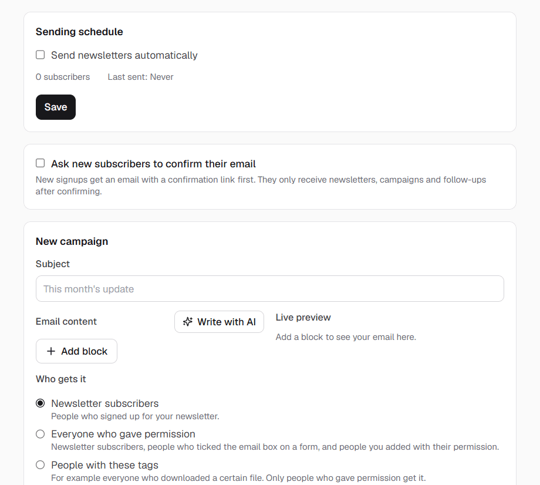

<strong>Voor je begint:</strong> je hebt een bedrijfsnaam en postadres nodig voor de voettekst van de e-mail. Ook heb je mensen nodig die toestemming hebben gegeven om gemaild te worden, meestal nieuwsbriefabonnees of mensen die het e-mailvakje op een van je formulieren aanvinkten.

## 1. Open Campagnes

Open je site, klik op **Beheren** en dan op het tabblad **Campagnes**.

## 2. Vul in wie verstuurt

Vul onder **Wie verstuurt** je **Bedrijfsnaam** en **Postadres** (straat, postcode en plaats) in. Ze staan onderaan elke campagne, nieuwsbrief en vervolgmail en een campagne kan pas worden verstuurd als beide zijn ingevuld. Tot dan blijven campagnes in de wacht en gaat er niets verloren: ze gaan uit zodra je ze hebt opgeslagen.

## 3. Schrijf het onderwerp

Typ onder **Nieuwe campagne** een **Onderwerp**, bijvoorbeeld "Het nieuws van deze maand".

## 4. Bouw de e-mail

De e-mail bestaat uit blokken. Klik op **Blok toevoegen** en kies een **Kop**, **Tekst**, **Afbeelding**, **Knop**, **Scheidingslijn** of **Witruimte**. Een e-mail kan maximaal 40 blokken hebben.

- Verplaats een blok met **Omhoog** en **Omlaag** en verwijder het met **Blok verwijderen**.
- Kies bij een afbeelding een van de foto's van je site of kies **Nieuwe afbeelding uploaden** (JPG, PNG of WebP) en voeg een **Beschrijving van de afbeelding** toe.
- Vul bij een knop **Knoptekst** en **Knoplink** in.
- Het **Live voorbeeld** toont je e-mail terwijl je hem bouwt.

Weet je niet wat je moet schrijven? Klik op **Schrijf met AI**, beschrijf onder **Waar gaat deze e-mail over?** waar de e-mail over gaat en klik op **Schrijf concept**. Kies een onderwerp en daarna **Gebruik dit concept**. Je kunt om **Korter**, **Vriendelijker** of **Formeler** versies vragen en ze **Ongedaan maken**. De AI gebruikt alleen wat je schrijft en wat je site zegt.

<strong>Let op:</strong> afbeeldingen zijn pas in de e-mail te zien als je site is gepubliceerd.

*Een nieuwe campagne: onderwerp, e-mailinhoud en wie hem krijgt. (Screenshot met Engelse interface.)*

## 5. Kies wie hem krijgt

Kies onder **Wie krijgt hem** een van deze:

- **Nieuwsbriefabonnees**: mensen die zich voor je nieuwsbrief hebben aangemeld.
- **Iedereen die toestemming gaf**: nieuwsbriefabonnees, mensen die het e-mailvakje op een formulier aanvinkten en mensen die je met hun toestemming hebt toegevoegd.
- **Mensen met deze tags**: bijvoorbeeld iedereen die een bepaald bestand downloadde.
- **Mensen in een segment**: een opgeslagen groep uit **Doelgroep**, dan **Segmenten**. Gebruik **Maak een segment** om er een te maken.

De pagina laat zien naar hoeveel mensen hij gaat. Mensen die geen toestemming gaven of zich hebben uitgeschreven, ontvangen hem nooit.

## 6. Kies wanneer

Kies onder **Wanneer** een van deze:

- **Nu versturen**
- **Inplannen voor later**, en kies dan een **Datum en tijd** (tot een jaar vooruit)
- **Toevoegen aan het vaste nieuwsbriefschema**, alleen voor nieuwsbriefabonnees
- **Opslaan als concept**

## 7. Bekijk, test en verstuur

Klik op **Voorbeeld** om de e-mail te zien zoals hij wordt. Zodra de campagne is opgeslagen, stuurt **Stuur mij een test** eerst een kopie naar jou. Ben je klaar, klik dan op de knop die bij je keuze past: **Nu versturen**, **Inplannen**, **Toevoegen aan schema** of **Concept opslaan**. **Nu versturen** vraagt je te bevestigen naar hoeveel mensen hij gaat.

Ingeplande campagnes en concepten staan onder **Gepland en concepten**. Daar kun je **Bewerken**, **Stuur mij een test**, **Planning annuleren** of **Verwijderen**. Een campagne die wordt verstuurd, toont de voortgang, bijvoorbeeld "Wordt verstuurd… 40 van 120".

<strong>Tip:</strong> stel eerst je eigen afzenderadres in, zodat de campagne van jou komt. Zie <a href="/nl/docs/set-up-your-sender/">Stel je afzender in</a>.

## Nadat hij is verstuurd

Verstuurde campagnes gaan naar **Verzendgeschiedenis**. Klik op **Statistieken bekijken** om te zien hoeveel er zijn bezorgd, geopend en aangeklikt. Openpercentages zijn bij benadering, omdat sommige mailapps afbeeldingen automatisch openen.

<strong>Let op:</strong> grote verzendingen gaan geleidelijk uit en het versturen kan voor je site worden gepauzeerd als te veel e-mails bouncen of als spam worden gemarkeerd. [BEVESTIG: verzendsnelheid en limieten om te noemen]

## Volgende stappen

<a class="next-card" href="/nl/docs/follow-up-emails/"><strong>Vervolgmails</strong>Reageer automatisch op nieuwe leads.</a>
<a class="next-card" href="/nl/docs/forms-and-leads/"><strong>Formulieren en leads</strong>Laat je doelgroep groeien.</a>

