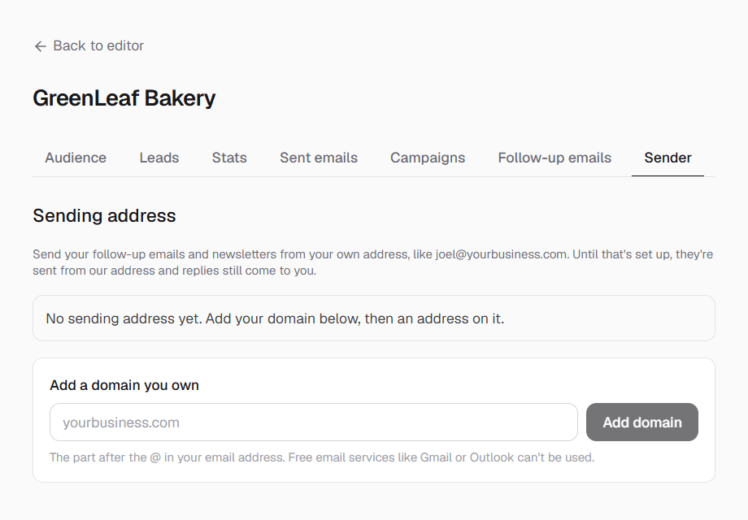

<strong>Voor je begint:</strong> je hebt een domein nodig dat van jou is en toegang tot de plek waar de DNS wordt beheerd, vaak je domeinprovider. Gratis e-maildiensten zoals Gmail of Outlook kunnen niet worden gebruikt, omdat je hun DNS niet kunt wijzigen.

Totdat je eigen afzender is ingesteld, gaan je e-mails uit vanaf het adres van Webgnr en komen antwoorden nog steeds bij jou. Er gaat niets kapot als je dit overslaat, maar e-mails vanaf je eigen adres ogen betrouwbaarder en komen vaker in de inbox terecht.

## 1. Open het tabblad Afzender

Open je site, klik op **Beheren** en dan op het tabblad **Afzender**. Het heet **Afzenderadres**.

## 2. Voeg je domein toe

Typ onder **Voeg een domein van jezelf toe** het deel van je e-mailadres na de @, bijvoorbeeld `jouwbedrijf.nl`, en klik op **Domein toevoegen**. Je kunt maximaal 5 domeinen toevoegen.

*Het tabblad Afzender voordat er een domein is toegevoegd. (Screenshot met Engelse interface.)*

## 3. Bewijs dat het domein van jou is

Webgnr toont één record om toe te voegen op de plek waar je de DNS van je domein beheert. Voeg het precies toe zoals getoond en klik dan op **DNS controleren**.

- Het record heeft bij je provider drie velden: **Type**, **Naam / host** en **Waarde / inhoud**. Vul ze apart in en gebruik **Kopiëren** naast elk veld.
- Wil je provider alleen het deel vóór je domeinnaam, vul dan alleen het eerste deel van de getoonde naam in.

Werkt het, dan verandert de status en zie je **Klaar: we hebben bevestigd dat dit domein van jou is.** Laat het record staan, want Webgnr controleert het af en toe opnieuw.

<strong>Let op:</strong> DNS-wijzigingen kunnen een paar uur duren voor ze zichtbaar zijn. Kan <strong>DNS controleren</strong> het record nog niet vinden, wacht dan en probeer het opnieuw.

## 4. Voeg de ondertekeningsrecords toe

Daarna komt **Laatste stap: laat je e-mails ondertekenen**. Webgnr toont nog 3 records, elk gemarkeerd met **Record 1 van 3** enzovoort. Voeg ze alle drie toe op de plek waar je de DNS van je domein beheert en klik dan op **Nu controleren**. Met deze records kan de e-maildienst mail van je domein ondertekenen, zodat die in inboxen terechtkomt in plaats van in spam.

- Wil je provider de volledige naam, voeg dan je domein toe achter de getoonde naam.
- Zijn de records nog niet gevonden, dan zie je een melding. Controleer of ze precies zijn zoals getoond, wacht en klik opnieuw op **Nu controleren**.

Staat alles op zijn plek, dan staat de status op **Klaar om te versturen**. Laat al je DNS-records staan.

## 5. Voeg een afzenderadres toe

Vul onder **Afzenderadressen** het formulier **Nieuw afzenderadres** in.

- **Adres**: het deel vóór de @, zoals `hallo`. Gebruik alleen letters, cijfers en . _ + -
- **Naam die lezers zien**: bijvoorbeeld "Sam van Jouw Bedrijf".
- Vink **Gebruik dit als afzenderadres van de site** aan om er het adres van te maken dat je e-mails gebruiken.

Klik op **Adres toevoegen**. Je kunt maximaal 20 adressen toevoegen. Het adres dat in gebruik is, heeft het label **In gebruik**. Om te wisselen klik je bij een ander adres op **Deze gebruiken**, of op **Naam wijzigen** om de weergavenaam te veranderen.

Een adres wordt pas gebruikt als zijn domein klaar is. Tot die tijd staat er dat e-mails nog vanaf het adres van Webgnr uitgaan.

## 6. Controleer waar je e-mails vandaan komen

Open **Vervolgmails** en kijk onder **Versturen als**. Daar staat het adres dat je reeks gebruikt. Campagnes en nieuwsbrieven gebruiken ook het afzenderadres van de site.

<strong>Tip:</strong> stuur jezelf een test vanuit een campagne of vervolgmail om de afzendernaam en het adres te zien zoals een lezer ze ziet.

## Als een domein niet meer werkt

Webgnr controleert je records elke dag opnieuw. Is een record meerdere controles achter elkaar verdwenen, dan toont het domein **Niet meer geverifieerd** en gaan je e-mails terug naar het adres van Webgnr. Zet het record terug zoals getoond en klik op **DNS controleren**. Om een domein en zijn adressen te verwijderen, gebruik je **Dit domein verwijderen**.

## Volgende stappen

<a class="next-card" href="/nl/docs/send-a-campaign/"><strong>Een campagne versturen</strong>Schrijf en verstuur je eerste e-mail.</a>
<a class="next-card" href="/nl/docs/follow-up-emails/"><strong>Vervolgmails</strong>Reageer automatisch op nieuwe leads.</a>

