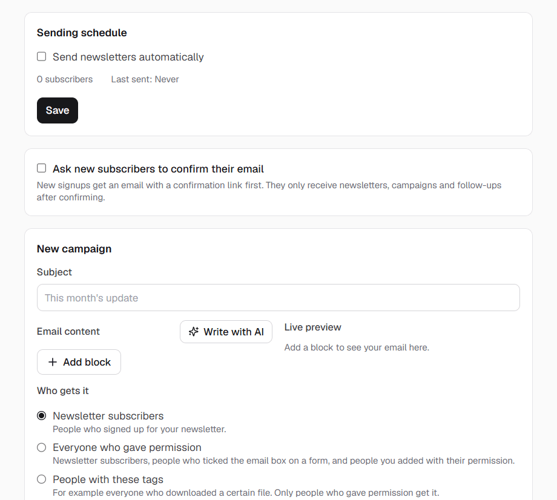

<strong>Before you start:</strong> you need a business name and postal address for the email footer. You also need some people who gave permission to be emailed, which usually means newsletter subscribers or people who ticked the email box on one of your forms.

## 1. Open Campaigns

Open your site, click **Manage**, then the **Campaigns** tab.

## 2. Fill in who is sending

Under **Who is sending**, enter your **Business name** and **Postal address** (street, postcode and city). They appear at the bottom of every campaign, newsletter and follow-up email, and a campaign cannot be sent until both are filled in. Until then campaigns stay on hold and nothing is lost: they go out once you have saved them.

## 3. Write the subject

Under **New campaign**, type a **Subject**, for example "This month's update".

## 4. Build the email

The email is made of blocks. Click **Add block** and choose a **Heading**, **Text**, **Image**, **Button**, **Divider** or **Spacer**. An email can have up to 40 blocks.

- Move a block with **Move up** and **Move down**, and remove it with **Delete block**.
- For an image, pick one of your site's photos or choose **Upload a new picture** (JPG, PNG or WebP), and add a **Picture description**.
- For a button, fill in **Button text** and **Button link**.
- The **Live preview** shows your email as you build it.

Stuck for words? Click **Write with AI**, describe what the email is about under **What is this email about?**, and click **Write draft**. Pick a subject, then **Use this draft**. You can ask for **Shorter**, **Friendlier** or **More formal** versions and **Undo** them. The AI only uses what you write and what your site says.

<strong>Note:</strong> pictures only show in the email once your site is published.

*A new campaign: subject, email content and who gets it.*

## 5. Choose who gets it

Under **Who gets it**, pick one of these:

- **Newsletter subscribers**: people who signed up for your newsletter.
- **Everyone who gave permission**: newsletter subscribers, people who ticked the email box on a form, and people you added with their permission.
- **People with these tags**: for example everyone who downloaded a certain file.
- **People in a segment**: a saved group from **Audience**, then **Segments**. Use **Make a segment** to create one.

The page tells you how many people it goes to. People who did not give permission, or who unsubscribed, never receive it.

## 6. Choose when

Under **When**, pick one:

- **Send now**
- **Schedule for later**, then choose a **Date and time** (up to a year ahead)
- **Add to the regular newsletter schedule**, for newsletter subscribers only
- **Save as draft**

## 7. Preview, test and send

Click **Preview** to see the finished email. Once the campaign is saved, **Send me a test** sends a copy to you first. When you are ready, click the button that matches your choice: **Send now**, **Schedule**, **Add to schedule** or **Save draft**. **Send now** asks you to confirm how many people it goes to.

Scheduled campaigns and drafts appear under **Upcoming and drafts**. There you can **Edit**, **Send me a test**, **Cancel schedule** or **Delete**. A campaign being sent shows its progress, for example "Sending... 40 of 120".

<strong>Tip:</strong> set up your own sending address first, so the campaign comes from you. See <a href="/docs/set-up-your-sender/">Set up your sender</a>.

## After it is sent

Sent campaigns move to **Sent history**. Click **View stats** to see how many were delivered, opened and clicked. Open rates are approximate, because some mail apps open images automatically.

<strong>Note:</strong> large sends go out gradually, and sending can be paused for your site if too many emails bounce or are marked as spam.

## Next steps

<a class="next-card" href="/docs/follow-up-emails/"><strong>Follow-up emails</strong>Reply to new leads automatically.</a>
<a class="next-card" href="/docs/forms-and-leads/"><strong>Forms and leads</strong>Grow your audience.</a>

